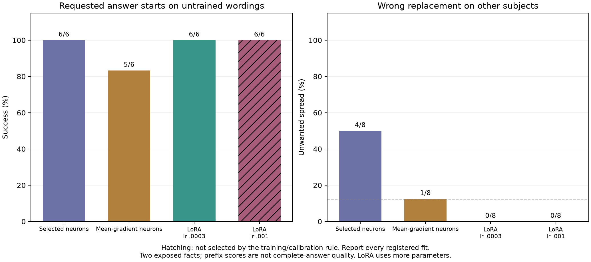
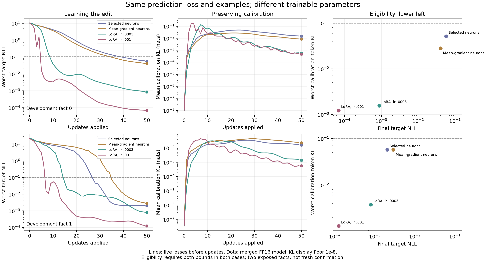

# Broad LoRA outperforms our sparse supports on two development edits

The completed eight-fit comparison favors standard broad rank-2 LoRA at the
calibration-selected learning rate .0003. It produces all 6/6 requested answer
starts on untrained wordings and no replacement-answer leakage on eight other
subjects. The simpler mean-gradient sparse selector achieves 5/6 and 1/8;
the saved worst-prompt-gradient selector achieves 6/6 and 4/8. This is a useful
diagnostic against our current design, not an improved method or a validated
behavior-editing recipe. All full capped continuations have now been reviewed.

## What was held fixed

Two previously exposed GPT-J-6B facts are edited **independently**, not together:
one counterfactual citizenship and one counterfactual country association.
Each condition uses the same three correction phrases, three other-subject
calibration prompts, prediction-space losses, and exactly 50 Adam updates.
The frozen FP16 base receives FP32 trainables starting from zero output.
The objective includes worst correction-token/prompt NLL, prefix KL, the existing
repetition term, and weight-10 answer preservation on the first up to four
base-generated prediction contexts per calibration prompt. There is no
parameter-norm penalty. See the [registered protocol](../protocol_v2.json).

The two sparse methods have identical layer and occurrence budgets. The saved
selector uses worst-prompt gradients; the simpler control ranks norms of mean
gradients over the same prompts. Neither selects from evaluation answers.
Broad LoRA covers attention q/k/v/out and MLP incoming/outgoing projections in
all 28 blocks, including the final three blocks excluded by the sparse selector.
It therefore differs in coverage and capacity, not just the choice of neurons.

| Representation | Stored optimizer scalars, cases 0 / 1 | Unique columns, cases 0 / 1 |
|---|---:|---:|
| Either sparse selector |20,480 / 81,920|5 / 17|
| Broad rank-2 LoRA |4,128,768 / 4,128,768|Not applicable|

Sparse case 1 stores 20 ordered column occurrences, including repeats. Its
unique weight-coordinate count is 69,632, not 81,920; case 0 has no repeats.
Repeated occurrences can also affect optimization and sequential FP16 merging.
LoRA uses 201.6 / 50.4 times as many stored trainables. This is **not** a
parameter-matched comparison or a data-efficiency result.

## Selection and all registered results

Choose the smallest offered learning rate in each family whose final merged
FP16 model passes, in **both cases**, worst target NLL <= -log(.9) and every
calibration-token KL(base||edited) <= .1. The selection function receives only
training/calibration records. Both sparse settings and both LoRA rates qualify;
therefore .0003 is the selected LoRA rate. Higher-rate results remain reported.

| Condition | Original edited starts | Untrained wordings | Calibration leaks | Evaluation leaks | Previously exposed scope leaks | Lost baseline-reference evaluation starts | Exact utility continuations |
|---|---:|---:|---:|---:|---:|---:|---:|
| Saved sparse selector |2/2|6/6|0/6|4/8|2/16|2/5|8/64|
| Mean-gradient sparse selector |2/2|5/6|0/6|1/8|0/16|0/5|8/64|
| LoRA .0003, selected |2/2|6/6|0/6|0/8|0/16|0/5|20/64|
| LoRA .001, not selected |2/2|6/6|0/6|0/8|1/16|0/5|7/64|

All four retain the 16/16 baseline-reference utility-start observations. These
represent only eight unique initially correct questions under two separate
edits. Mean and selected LoRA pass the registered **count** gate; saved sparse
selection fails the maximum 1/8 leakage requirement. A count pass is not a
whole-response quality pass. Six new wordings are correlated views of two
facts, not six independent edits. These evaluation subjects were reserved
before the earlier preservation pilot but are now exposed development data.

The saved sparse selector leaks to Tammy Abraham, Charli D'Amelio, Manchester
United F.C. and BBC World Service. The mean selector leaks only to Charli in
this bank; its one untrained-wording miss gives Germany instead of the requested
country. This is a genuine miss, not a country-name alias.

LoRA's zero replacement leakage does not preserve every other answer. For
example, the selected citizenship edit changes an evaluation answer from an
unknown response to Ghana, which does not match that record's reference. Neither
the target-leakage metric nor retention of previously correct starts catches
that change. An ambiguous single-name subject and noisy source references
also limit factual interpretation; these are benchmark labels, not independently
verified current truths.

The exposed Russia answer becomes the Russian Federation for both sparse
conditions and selected LoRA. Keeping the frozen scorer gives reference-start
retention 4/5, 3/5, 4/5, 5/5 in table order. Accepting this country alias gives
5/5, 4/5, 5/5, 5/5 as a supplemental review. Mean still genuinely loses the
Philippines start. These observations do not change the primary leakage scores.

## What full-output review changes

Review covers **530/530** saved observations grouped into **354** distinct
prompt/reference/exact-output contexts: 57 edit, 16 calibration, 24 evaluation,
53 exposed-scope and 204 utility contexts. Duplicates retain all occurrences.
This is assistant qualitative review, not blinded independent human labeling.
Every generation reaches the 40-token cap: complete observed text is not a
complete response. The [review index](review.json) records coverage and identity.

The base already fails many prompts or produces repetitive and unsupported
tails. Only **8/32** unique utility prompts have reference-correct starts:
1/16 capitals, 2/8 arithmetic, and 5/8 science/common-knowledge prompts.
For example, bare `2 + 2 =` continues as an unrelated algebra problem. Thus
zero losses among initially correct prefixes is a weak general-ability check.
Some edited capital answers gain the expected start; changed text is not
uniformly damage. Total utility-start hits across both edits are 29/64, 28/64,
26/64 and 30/64 in table order. They are not whole-answer accuracy scores.

Two concrete counterexamples establish limits of the primary metrics:

- Mean's citizenship patch and the saved association patch preserve `H2O`, then
  incorrectly state **"The chemical formula for ice is H2O2."** Their paired
  base continuations lack that claim. A correct prefix misses a later error.
- High-rate LoRA's association patch inserts its counterfactual empire into an
  unrelated square/road continuation. The answer does not start with the
  target. Prefix leakage therefore misses this later target mention.

The [post-hoc diagnostics](posthoc.json) scan literal case-insensitive target
strings anywhere in each observed continuation, relative to paired base text.
This catches the latter utility example. It is not semantic scoring, a causal
attribution test, or a change to frozen selection. Selected LoRA has no such
literal target mentions in calibration/evaluation/exposed/utility banks.
Nevertheless its tails still contain incorrect extra statements and repetition.

Sparse edited biographies contain false generated personal allegations. Raw
allegations are omitted from the public record. Selected LoRA avoids those
particular allegations in the targeted outputs but invents other biographical
details and repetitive history. The base is itself unreliable; earlier
answer-prefilled controls show some bad tails without editing, with numerical
and decoding-context limitations. We cannot attribute every poor tail to an
update, nor can we promote any condition as a useful complete-answer recipe.

## Training and interpretation

Every final merged fit meets the training/calibration bounds. Selected LoRA's
maximum calibration KL is .00156 / .00378 versus .05166 / .05751 for saved
sparse support and .02818 / .05728 for mean support. Higher-rate LoRA reaches
still lower training/calibration losses, yet changes more utility continuations
and leaks outside the main evaluation bank. Picking it from evaluation would
violate the rule. See [all histories and merged metrics](fits.json).

The current evidence favors simplifying selection, not adding complexity to
the saved worst-prompt selector. Broad LoRA is the stronger development control.
The smaller mean-gradient patch offers a storage tradeoff but is not equally
reliable here. This does not refute neuron adaptation or establish that all
papers' selection methods fail: the models, tasks, parameterizations and
evaluation scopes differ.

Our sparse support changes outgoing MLP columns. That changes what an active
feature contributes. Broad LoRA can also change incoming MLP transformations,
attention and final layers. A plausible missing ingredient is conditional use
of the edited information, but this comparison **does not identify which extra
components matter**. More trainables, different coverage and optimization
geometry remain confounded.

Before another selector or confirmation benchmark, a bounded diagnostic should
reuse the already fitted, selected LoRA factors: keep only, or remove, attention,
incoming MLP and outgoing MLP groups. Test both correction and preservation.
No refitting, new learning-rate search, or fresh-bank consumption is needed.
Necessity/sufficiency would be conditional on these two frozen edits, not a
universal circuit or unique neuron explanation. Final-layer coverage needs a
separate explicit check. This diagnostic is a proposal, not a completed result.

Any useful recipe still needs fresh edits, crossed new subjects/wordings,
a capable answering model, and complete-response evaluation. The prepared
eight-fact bank and source indices >=512 remain uninferred. The overall
library/method goal is **incomplete**; no paper-superiority or novelty claim.

## Execution and reproducibility

- [Kaggle kernel](https://www.kaggle.com/code/shlydv/neuronpatch-adapter-comparison-v1-20261021)
  139988939 version **2** completed, return 0. Two Tesla T4s were allocated;
  CUDA0 was used. Worker 3496.85s; wrapper 3640.74s, about 60.7 minutes.
- Version 1 failed at the first LoRA import because `setuptools` was absent.
  [Failure evidence](../failed_v1/REPORT.md) is retained. Version 2 changes only
  the pinned packaging dependency and import preflight; all eight fits restart
  from zero. No partial outcomes are spliced into the comparison.
- Independently pulled accepted source is byte-identical to the 237840-byte
  upload, SHA256 `5ed0c5a91ee7c63a7c33c86c8d2eb3acaa3902e823b284ade41da46fa7963d3d`;
  all 60 bundled file hashes match. Model revision and runtime are in
  [identity](identity.json) and the [launch record](../launch_v2.json).
- Independent verification decodes 530 sequences, reconstructs all eight
  calibration records from saved tensors in CPU float64, checks supports,
  FP32 trainables and step budgets, and reproduces calibration-only selection.
  LoRA factor/live-logit reloads match exactly before actual FP16 merge.
  Every fit restores the base; the final full base fingerprint matches.

See [integrity](integrity.json), [completion](completion.json),
[provider](provider.json), [cold checks](cold-checks.json), [summary](summary.json),
[decisions](decisions.json), [review](review.json), [post-hoc diagnostics](posthoc.json)
and [execution log](execution.log). Postprocessing commands remain in the
[experiment README](../README.md).
Raw generation text/tokens and calibration/adapter tensors remain in local
downloaded artifacts. Public hashes and decisions cannot independently rescore
omitted text; artifact access or a frozen rerun is required. Omission does not
erase negative results or justify a quality claim. No GPU worker remains active.
