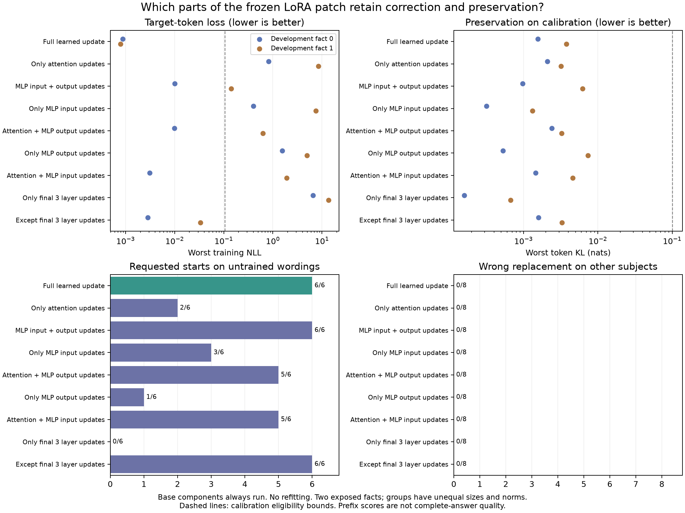

# Complete frozen-adapter diagnosis

All **18** registered interventions on the two exposed GPT-J-6B edits are
complete and independently verified. The original worker timed out after16;
the finisher repeats212 exact base/full controls, copies14 verified nonfull
interventions unchanged, and computes the missing pair. It returns0 after
1481.19seconds (24.7minutes), with **zero fits**. The [partial report](../partial_v1/REPORT.md)
preserves the original timeout evidence.

## All results

Every base component still computes. We remove **learned parameter updates**,
not base attention heads, entire layers or neuron activations.

| Learned updates retained | Original starts /2 | Untrained starts /6 | Other-subject target leaks /8 | Exact utility continuations /64 | Training/calibration bounds |
|---|---:|---:|---:|---:|---|
| Full adapter |2|6|0|20|Pass|
| Attention only |1|2|0|42|Fail|
| Incoming + outgoing MLP |2|6|0|26|Fail|
| Incoming MLP only |1|3|0|48|Fail|
| Attention + outgoing MLP |2|5|0|25|Fail|
| Outgoing MLP only |1|1|0|31|Fail|
| Attention + incoming MLP |2|5|0|40|Fail|
| Final three layers only |0|0|0|51|Fail|
| Everything except final three layers |2|6|0|23|Pass|

Full and without-final-three pass the frozen conditional **count** gate. This
does not establish complete-answer quality. See [scores](summary.json),
[interventions](interventions.json) and [scope decisions](decisions.json).
Six untrained wordings are correlated views of two facts, not six independent
edits. All conditions retain initially reference-correct utility starts, but
the base has only8/32 such unique starts. Exact text agreement is stability,
not factual correctness.

MLP-only generates6/6 starts although its second fact's minimum training-token
probability is about86.8%, below the registered90% bound. Both measurements
stand: the threshold failure neither erases transfer nor validates the subset.

## What the last pair resolves

Final-three-only worst training NLL is6.53291/13.70316 for cases0/1;
without-final-three is.002811/.033598, versus full.000871/.000793. The
second without-final-three case's minimum target-token probability is about
96.7%. Thus this fitted patch's measured correction does not require its
learned final-three-layer updates. Keeping only those updates gives0/6
untrained starts; excluding them retains6/6. This removes one suspected
explanation for the gap with our sparse editor. It does not show that excluding
final layers during training is always harmless or explain all FiNE differences.

Incoming and outgoing MLP updates together remain a useful train-from-zero
hypothesis. Incoming changes could affect when a feature is used and outgoing
changes what it contributes, but the experiment does not identify a semantic
gate. Co-trained group removal is not refitting; capacities and norms differ.
No unique/minimal circuit or generally superior parameterization is demonstrated.

## Complete review of the observed outputs

All **1060** observations are covered by assistant qualitative reading of
**240** distinct prompt/reference/exact-output contexts:227 previously reviewed
contexts match exactly and13 are newly read. Every continuation reaches its
40-token cap. This is review of all observed text, not complete responses or
blinded human factuality labeling. The [review index](review.json) records
coverage and hashes; raw generated text/tokens, including false personal
allegations, are omitted.

The final pair does not fix response quality. Without-final-three retains
requested counterfactual starts but adds unrequested historical narratives
and repetition. Final-three-only mostly retains baseline/generic completions;
its inspected edit miss gives the United States, not an alias for the requested
counterfactual empire. Other new contexts give generic capital answers,
unrelated algebra and repeated country associations.

The earlier failure remains: MLP-only retains all requested starts but
reintroduces false generated personal allegations absent from the full adapter's
corresponding continuation. Full also fabricates other details. The
[post-hoc literal scan](posthoc.json) finds no new target strings anywhere in
unrelated banks across all18 interventions. That is not semantic preservation
or factual quality. No condition is a validated editing recipe.

## Provenance and verification

- [Kaggle finisher](https://www.kaggle.com/code/shlydv/neuronpatch-frozen-adapter-finish-v1-20261021),
  kernel140062463 version2: COMPLETE, return0, CUDA0 of two allocated Tesla T4s.
  See [provider](provider.json) and [execution log](execution.log).
- The independent [verifier](integrity.json) decodes1060 sequences, checks212
  bit-identical parent controls, reconstructs20 calibration records in CPU
  float64 and validates18 interventions plus original base restoration.
- [Completion](completion.json), [controls](controls.json) and
  [resume provenance](resume.json) distinguish14 copied nonfull interventions
  from two repeated full controls and two new interventions. The worker
  generates318 observations; the combined logical grid has1060. The original
  [protocol](../protocol_v1.json) is unchanged.
- The independently pulled accepted246977-byte script matches the frozen
  upload, SHA256 `6f68fb20222181e6a127cffb3fab60d3d602de6374958615c57321520f409d7d`.
  All66 packed file hashes and the downloaded submission match. See
  [source integrity](source_integrity.json) and [frozen identity](../frozen_finish_v1.json).
- Finisher version1 was cancelled while queued after Kaggle rejected the failed
  notebook as an input source. Version2 changes input metadata only; a private
  dataset supplies the same checkpoint files. All hashes pass before model
  loading. No fitted factors or inference settings change.

No independent GPU experiment started while the finisher was pending. The
experiment is complete; the library/method objective **is not**. The next
[paired MLP/full-response implementation](../../paired_mlp/README.md) has passing
numerical, tokenizer and packaging checks, but no pretrained behavioral advantage
yet. Fresh confirmation inputs remain uninferred.
