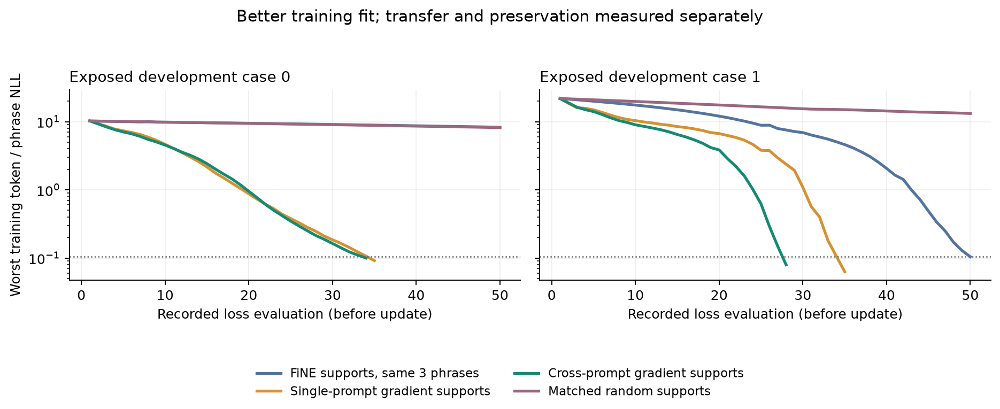

# Positive prefix-transfer pilot; useful behavior still unproven

**The frozen cross-prompt gradient candidate passes its advancement gate.**
It produces the requested counterfactual answer prefix on all six untrained
wordings, versus three for FiNE supports trained on the same examples, four for
single-prompt gradient selection, and zero for layer/multiplicity-matched random.
It retains all eight baseline-correct utility prefixes under each of the two
edits. This is a controlled positive component result on **two exposed facts**,
not a reliable answer-editing recipe or a claim to surpass the papers.

**The completed [frozen subject-scope follow-up](../scope_v1/REPORT.md) fails
specificity:** the candidate introduces the new target for 9/16 other subjects,
including all eight people in the citizenship case. Original FiNE leaks 10/16,
augmented FiNE 8/16, single-gradient 5/16, and ineffective random 0/16. The transfer
gate below remains passed, but the candidate must not advance unchanged as a
useful subject-specific editor.

Full output review substantially limits that positive result. The base answers
only 8/32 utility prompts with the reference prefix. The candidate changes most
utility continuations, sometimes adding useful answer names and sometimes adding
repetition, irrelevant topics or unsupported details. Some targeted continuations
invent serious allegations about a real person. These are fabricated model
outputs, not facts; raw continuation text is not reproduced in public examples.
No model or patch is recommended for deployment from this pilot.

## Frozen comparison and execution

The [protocol](../protocol_v1.json), [inputs](../inputs_v1.json) and
[source/data submission hashes](../submission_v1.json) were frozen before the run.
First two official KnowEdit cases, reused from the verified GPT-J-6B parity test:
one citizenship edit and one award/country-association edit. Each new fit gets
the same original prompt plus two authored training phrasings. Evaluation uses
the official rephrase plus two further authored wordings per fact. The facts and
official rephrases were previously exposed; four new wordings were fixed before
this run. This is development evidence, not fresh method confirmation.

The four new fits per case use the same target, max 50 updates, rate .001,
worst-prompt/token NLL, mean prefix KL/repetition penalty and global norm penalty.
Only supports differ. There are 20,480 trainable BF16 scalars for case 0 and 81,920
for case 1. The saved original FiNE patch is a separate single-prompt reference;
it is not retrained and must reproduce its known generations exactly.

Kaggle version 1, kernel 139844236, completed successfully on 2026-10-20:

- Pinned `EleutherAI/gpt-j-6B`, revision
  `47e169305d2e8376be1d31e765533382721b2cc1`, FP16 base, BF16 deltas,
  Torch 2.4.1, Transformers 4.40.0; two T4s allocated, model uses CUDA0.
- All eight new fits complete; all nine saved reference continuations reproduce
  exactly; restore-generation checks pass after every condition.
- Initial/final full base fingerprint:
  `825b6a5e7b28bc45ff833ae39ff73cf274b203039cce3e14bc7e7b20b3cdd7c0`.
- Independently pulled executed script is byte-identical to the submitted bundle,
  SHA256 `6fc813b59310bcc53d523007ad49509c767b98778c3d80bebbc7c768f94e5f1a`.
- Downloaded artifacts verify: source/data identity, all paired comparisons,
  matched random layer/duplicate patterns, scalar budgets, finite BF16 tensors,
  and 466 decoded sequences against the pinned tokenizer.
- Worker time 2595.80 seconds; wrapper/setup time 2656.82 seconds, about 44.3 minutes.
  API status COMPLETE and wrapper return 0. Log-stream disconnects did not cause
  resubmission; only one version/worker ran.

See [integrity](integrity.json), [completion](completion.json),
[provider](provider.json), [execution log](execution.log) and
[timed stages](runtime_timeline.json). Logs contain training values, not raw
answer continuations. Full raw outputs, token IDs and compact deltas are retained
in the local downloaded artifact directory.

## Frozen generated-prefix results

| Condition | Original prompts | Three-phrase bank | Untrained wordings | Old-correct utility retained |
|---|---:|---:|---:|---:|
| Saved original FiNE |2/2|3/6|1/6|16/16|
| FiNE supports + three-phrase training |1/2|3/6|3/6|15/16|
| Single-prompt gradient supports + same training |2/2|6/6|4/6|16/16|
| Cross-prompt gradient supports + same training |2/2|6/6|6/6|16/16|
| Matched random supports + same training |0/2|0/6|0/6|16/16|

The three-phrase bank includes prompts not trained on by the original saved FiNE
reference. All six are training prompts for the four new conditions. Prefixes
use the declared normalization/word boundary rule; numeric utility prefixes also
reject different decimal or thousands values. These are **requested answer
starts, not complete-answer accuracies**. The target edits are deliberately
counterfactual, not factual improvements to real-world knowledge.

The candidate gains 3/6 over augmented FiNE and 2/6 over single-prompt gradient
selection, retains both original prompts and introduces no additional lost
baseline-correct utility prefixes. Baseline utility count 8 meets the declared
minimum exactly. Thus the original gate passes without changing its criteria.
The six wordings are correlated views of two facts; no significance or broad
sample-size claim follows from 6/6.

The single-gradient and cross-prompt conditions both get 3/3 on case 0. Their
two-prefix difference occurs entirely in case 1. This is narrow evidence for
using multiple phrasings during discovery, not proof that this particular
worst-prompt scoring formula beats simpler multi-prompt gradient averaging.

## Training fit and parameter accounting



| Case / condition | Updates | Final worst training NLL |
|---|---:|---:|
|0 FiNE supports + augmentation|50|8.293|
|0 single-gradient|34|0.092|
|0 cross-prompt gradient|33|0.100|
|0 matched random|50|8.179|
|1 FiNE supports + augmentation|49|0.104|
|1 single-gradient|34|0.063|
|1 cross-prompt gradient|27|0.080|
|1 matched random|50|13.190|

Actual update-gradient selection makes the fixed small support more trainable
on this phrase bank, rather than merely matching FiNE's descriptive attribution.
Extra examples alone do not recover case 0 with the original FiNE support.
This does not establish why each selected neuron is useful or what it represents.

For case 1, independent occurrences number 20 but unique columns are 19 for FiNE,
16 for single-gradient, and 17 for cross-prompt/random. Duplicate occurrences
alter effective capacity and norm penalties; equal scalar budgets are not equal
unique support. Parameter delta norms for cross-prompt are 2.247/3.128 versus
3.357/8.903 for augmented FiNE and 5.752/10.156 for random. Larger raw delta size
does not explain the observed candidate gain. Linear summed-column norms are
also recorded; they are not exact FP16 merged-weight changes.

Per-fit times include export and evaluation and are about 218–239 seconds,
dominated by operations beyond the optimizer loop. No training-only speedup is
claimed. Discovery shares 15 full-model forward/backward passes across the two
gradient strategies; standalone single-prompt discovery would need 5. Observed
post-reference restore/discovery intervals are 3.59/6.65 seconds, including a
restore generation, not pure selection timings. FiNE supports were already
cached, so this run cannot benchmark total discovery efficiency against FiNE.

## Preservation and whole-output review

Keeping 16/16 old-correct prefixes means **eight unique utility questions checked
under two different edits**. It is not preservation of 32 good answers, 16
independent questions, or all model capabilities. Many base answers continue
generic descriptions instead of naming the requested entity. A few contain the
name later, beyond the first-prefix rule.

Cross-prompt editing changes 29/32 utility continuations in case 0 and 27/32 in
case 1. Change alone is not damage. For example, case 1 increases total utility
prefix hits from 8/32 to 23/32, largely by naming capitals where the base starts
with generic descriptions. That may reflect a general answer-style change rather
than newly learned geography. The subsequent continuations still contain
repetition and unverified extra facts. Case 0 removes a later Berlin mention
within the observed 40 tokens despite passing the narrow prefix-retention test.
This does not prove erased knowledge; it exposes what that metric misses.

The six cross-prompt untrained-wording continuations all start with the requested
target. After that they can drift into unrelated geopolitical material, repeat
the same sentence, invent biography/allegations, or supply unsupported history.
The 40-token budget does not expose complete endings. We also have not isolated
whether these tails come from the base model conditional on the forced new
answer, or are introduced by the edit itself. A primed-base continuation control
would separate those possibilities. Do not attribute every bad tail to editing.

The same early columns, including layer 3 feature 15160 and layer 5 feature 2412,
appear across these different edits. Together with widespread continuation
changes, this motivates testing high-leverage generic channels and subject
specificity. It is not evidence that these are dedicated citizenship or award
neurons. Activation-matched controls and simpler mean-gradient selection remain
unrun alternatives to explain the benefit.

## Post-hoc update-direction check, before scope results

The [saved-delta geometry](delta_geometry.json) qualifies the shared-column
hypothesis. The consensus patches reuse layer 3 feature 15160 and layer 5 feature
2412 across the two facts, but their respective update-vector cosines are only
0.046 and 0.050. These shared columns account for about 40%/42% of each patch's
linearly summed squared update norm, so their reuse is substantial.

For the **same fact**, single-gradient and consensus updates on shared columns
agree much more: cosines 0.949–0.953 in case 0 and 0.897–0.948 in case 1. Thus
shared support is compatible with different learned update content across the
two edits. Reuse alone does not establish one common output bias, and excluding
shared neurons without further evidence would be premature.

This is a post-hoc parameter-space diagnostic, with no model inference or new
fitting. Duplicate occurrences are summed in float64; these are not exact
sequentially merged FP16 weight changes. Vector cosines do not measure semantic
similarity or prove which components cause transfer, interference or output-style
changes. Different activation contexts and downstream processing still matter.
The pending scope probe supplies the behavioral test.

## What advances, and what does not

The controlled positive result justifies investigating this selector further.
It does not justify a default public recipe, whole-answer quality claim,
data-efficiency claim, novelty claim, or superiority to NeST/SafeNexus/SpaRTA,
which operate in different settings. Strong low-rank baselines, fresh cases,
another model and another task family remain necessary for the library goal.

The already frozen [same-relation/different-subject bank](../scope_protocol_v1.json)
subsequently ran all five conditions at saved strength, with exact cold-load checks
and no fitting. Its [completed result](../scope_v1/REPORT.md) shows substantial
target leakage, despite retaining global utility prefixes in this pilot. Separate
preservation calibration and evaluation subjects are needed before any repaired
candidate proceeds to fresh confirmation. A stronger answering model and
complete-response evaluation remain necessary for a useful library workflow.

## Public evidence and reproduction

[Summary](summary.json), [per-probe decisions](answer_decisions.json),
[utility decisions](utility_decisions.json), [support selections](case-0-selection.json),
[training histories](fits.json), [secondary utility counts](secondary_utility_counts.json),
and [output review](output_review.json) are public. Per-probe outputs are represented
by hashes and scoring decisions; raw text/token IDs are omitted to avoid
republishing fabricated allegations. This means the public files alone cannot
independently rescore those omitted continuations. Raw local data and deltas are
available to the experiment owner; the frozen code, source pins, inputs and
artifact hashes support rerunning the experiment. This omission is explicit and
does not remove the negative qualitative findings.

The [README](../README.md) provides preparation, execution, verification and
analysis commands. Reproduce the figure with:

```sh
python -m experiments.fine_transfer.plot \
  --fits experiments/fine_transfer/pilot_v1/fits.json --output /tmp/training.png
```

Reproduce the saved-update diagnostic without loading a model:

```sh
python -m experiments.fine_transfer.delta_geometry \
  --pilot-results /path/to/transfer-results/results \
  --references /path/to/original-frozen-data --output /tmp/delta-geometry.json
```
