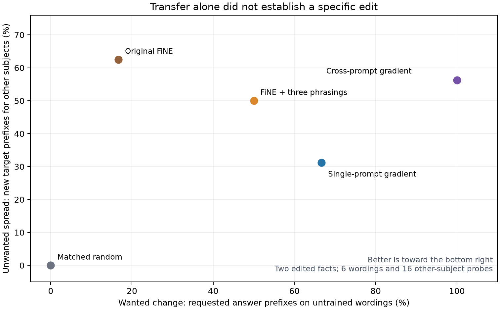

# Frozen edits fail subject specificity

The cross-prompt gradient patch transfers the requested answer to all six
untrained wordings in the earlier pilot, but also introduces that target for
**9/16 other subjects** in the frozen follow-up. In the citizenship case, all
eight other people receive the newly trained country. The earlier prefix-transfer
gate remains passed; it does not establish a useful subject-specific edit.

This is not uniquely a failure of the new selector: the saved original FiNE patch
leaks on 10/16 probes, augmented FiNE on 8/16, and single-gradient selection on
5/16. Matched random leaks on none but also failed every untrained-wording edit.
The prospective prediction that gradient patches would leak more than original
FiNE is **not supported in the aggregate**. Each condition must be reported.



## Complete frozen comparison

| Condition | Wanted transfer, previous pilot | Other-subject target leakage | Baseline-reference prefixes retained |
|---|---:|---:|---:|
| Saved original FiNE |1/6|10/16|2/5|
| FiNE + same three phrasings |3/6|8/16|2/5|
| Single-prompt gradient |4/6|5/16|2/5|
| Cross-prompt gradient |6/6|9/16|2/5|
| Matched random |0/6|0/16|5/5|

These are observed prefixes, not complete-answer accuracies. There are two
exposed edited facts, eight other-subject probes for each, and correlated
wordings. The transfer and scope inputs were fixed before reviewing pilot
outputs. New off-subject target prefixes were absent at baseline. There is no
training, scale change or patch selection in this follow-up.

The citizenship case separates successful editing from specificity particularly
clearly: original FiNE leaks 7/8, augmented FiNE 0/8, single-gradient 4/8,
cross-prompt 8/8, random 0/8. Augmented FiNE also failed to train that original edit
in the pilot; its lack of leakage is not a useful solution. In the country-
association case the corresponding counts are 3/8, 8/8, 1/8, 1/8, 0/8. The augmented
FiNE patch repeatedly emits the new target for all eight unrelated subjects.

## Output review and scoring limits

All 16 baseline and 80 edited off-subject outputs and all 12 answer-prefilled tails
were reviewed, beyond the frozen prefix counts. The citizenship patch's leakage
is visible in explicit statements about the other subjects, not just a tokenizer
or article-normalization artifact. It also changes both baseline-prefix-correct
citizenship answers to the new country. Other outputs can change to different
wrong answers without mentioning the requested target; leakage alone does not
capture all interference. Changed text alone is not uniformly damage.

One frozen prefix loss in both gradient conditions is an alias mismatch: the
reference and base say "Russia", while the edited answer begins "the Russian
Federation". This preserves the named country. Keep the original counts above,
but the supplemental accepted-alias review retains 3/5 baseline answer identities
for those conditions rather than 2/5. This does not rescue their target leakage.
Some other source labels are ambiguous, historical or incomplete; they are not
independently verified present-day facts. Do not convert these counts into a
broad factual-accuracy score or silently add labels to the frozen scorer.

Input inspection explains a gap in the supplied locality probes for these two
source records: they ask other relations about the edited subject, plus a
negated original-relation question in case 0. They do not ask the edited relation
about other subjects. Thus preserving those source probes or unrelated global
utility questions cannot establish the missing form of subject specificity.
This is a finding about these inspected records, not the entire paper benchmark.

The six answer-prefilled controls supply the intended target as part of the
input, then compare 40-token base and cross-prompt-patch continuations. All six
tails differ; all twelve reach the token cap. Base continuations already add
unsupported biography, history or repetitive material conditional on the new
answer. Edited continuations also add unrelated material, repetition and, in one
paired example, a serious fabricated allegation absent from its base tail.
These generated allegations are not facts and are not republished here.

Thus poor continuations cannot all be blamed on the patch, but base weakness
does not excuse additional patch-induced output problems. This small qualitative
control is not an overall quality ranking, and supplying the answer never counts
as editing success. Output review decisions and hashes are in [review.json](review.json).

## What this changes

Do not advance the current candidate unchanged to a larger confirmation run.
It learns a transferable answer response, with substantial relation-wide spread.
The appropriate next question is whether we can retain transfer while binding
the change to the intended subject.

The current source-faithful objective preserves predictions inside the edited
prompt, ending before its first answer prediction. It does not preserve answers
for other subjects. This is an objective-scope gap, not an implementation mismatch.
Selection and preservation should be tested separately: a simpler mean-gradient
selector remains a missing control, while any preservation modification needs
separate calibration subjects and held-out subjects for evaluation. A strong
low-rank baseline must receive the same correction/preservation data and a
reasonable tuning budget. Earlier protected-row experiments already show that
success on finite anchors alone cannot establish general preservation.

The prepared eight-case bank has not been inferred on. It remains prospective
input preparation, not evidence for this method. A repaired approach must earn
progress on transfer, subject specificity and complete outputs together. The
main library goal remains unmet; no novelty or paper-superiority claim follows.

## Execution and independent verification

- Private Kaggle kernel 139856073 version 2 completed on 2026-10-20, return 0.
  The earlier accepted version 1 was cancelled while queued, before replacement.
  Actual worker hardware was TeslaT4 (two allocated, CUDA0 used), despite a P100
  request. No claim that changing GPU pools resolved the queue is supported.
- Pinned GPT-J-6B and reference runtime; worker 1884.44 seconds, wrapper 1947.49 seconds
  (about 32.5 minutes). Zero fits; all ten saved patches at their original strength.
- All 20 cold-loaded reference sequences match their frozen hashes before any
  new probe. All ten per-condition restoration checks and final full base
  fingerprint pass.
- Independently pulled executed source is byte-exact to the frozen 817614-byte
  bundle, SHA256 `669a356b968d61e9dc690726c50ba352e2223a953d87695753fa29d3b6ff0bf4`.
- Download verification checks all 108 new stored sequences against the pinned
  tokenizer, all input/patch hashes, condition completeness and execution order.

See [integrity](integrity.json), [completion](completion.json),
[provider](provider.json), [cold checks](cold-checks.json),
[summary](summary.json), [per-probe decisions](decisions.json) and
[execution log](execution.log). Raw text/tokens remain in local downloaded
artifacts; the public hashes and decisions cannot independently rescore omitted
text without artifact access or rerunning the frozen experiment. This limitation
is explicit and does not hide the negative findings.

Reproduce the figure from the checked result summaries:

```sh
python -m experiments.fine_transfer.plot_scope \
  --pilot experiments/fine_transfer/pilot_v1/summary.json \
  --scope experiments/fine_transfer/scope_v1/summary.json \
  --output /tmp/transfer-scope.png
```
