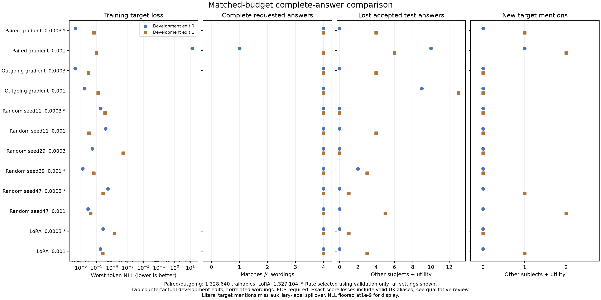

# Complete-answer, matched-budget pilot

The 24-fit Qwen3-4B-Instruct-2507 pilot completed successfully. We can train
complete requested answers on these two exposed development facts, but this
experiment **does not demonstrate an advantage from gradient-selected neurons**.
The predefined advance criteria fail. No fresh confirmation cases were used.

All methods use approximately 1.33 million trainable scalars, the same correction
and preservation data, 50 updates, and the same two learning rates. Rates below
were selected using validation answers only; all rates remain in [scores](summary.json).

| Selected method | Complete transfer answers /8 | Lost initially accepted preservation answers /49 | New target mentions in preservation tests |
|---|---:|---:|---:|
| Gradient-selected paired neurons |8|4|1|
| Random paired neurons, seed11 |8|0|0|
| Random paired neurons, seed29 |8|5|0|
| Random paired neurons, seed47 |8|1|1|
| Official rank-one MLP LoRA |8|1|0|

The outgoing-only family has no rate eligible under the frozen validation
preservation rule. Both rates nevertheless reach 8/8 transfer answers; they
lose four and 22 initially accepted preservation answers respectively.

Eight transfer questions are correlated wordings of **two facts**, not eight
independent edits. Preservation counts combine eight scope and 46 utility
observations, of which 49 were initially accepted. The same utility prompts
occur under both independent edits, so these are not 54 independent questions.

## Reading the actual answers

We read all 216 distinct prompt/reference/output contexts covering 1417
observations. The selected gradient-paired condition changes the unrelated
Lakers country answer to the injected counterfactual target. It also changes
the chemical symbol for oxygen from O to O₂. These are genuine interference,
even though the requested edit itself transfers to every tested wording.

Two other scored losses for that condition are the correct full formal name
of the United Kingdom, absent from the frozen answer aliases. The selected
LoRA condition's single scored loss is the same valid alias. Consequently,
four scored losses must not be described as four factual mistakes, and this
test does not establish factual damage from the selected LoRA condition.
The original scores are preserved; this qualitative finding does not silently
rewrite the protocol or validation selection.

Random seed11 has no measured losses or new target mentions in these test
banks; other random seeds do interfere. This is a small development result,
not evidence that random selection is universally better. Several higher-rate
conditions produce clear country mixing, malformed answers or repetition.
Some baseline prompts/references remain ambiguous, and strict requested output
form can penalize informative extensions. None of these qualifications removes
the observed target leakage.

## What changed and what remains

The earlier GPT-J diagnostic showed that correct answer openings could coexist
with poor continuations, and that the fitted correction did not require its
last-three-layer updates. This pilot replaces prefix scoring with complete
responses through EOS on a more capable instruction model and matches the
trainable parameter budget against LoRA and random controls.

That fixes an important evaluation and comparison problem. It does not solve
selective editing: the simple gradient selector improves the requested answer
without reliably protecting unrelated answers. The selected methods reach a
transfer ceiling here, so this task cannot establish a correction advantage.
The next methodological question is what predicts collateral damage and whether
that information improves selection beyond random and LoRA, with output-aware
review and fresh confirmation reserved for a justified candidate. We should not
claim a new algorithm, a robust default recipe or superiority to the papers.

The earlier high-rate endpoint discrepancy remains unresolved: a last sampled
pre-update training loss is not the final all-prompt merged loss, and the
worker did not retain pre-merge endpoint logits. The completed results cannot
distinguish optimization effects from low-precision merging for that discrepancy.

## Verification

- [Kaggle job](https://www.kaggle.com/code/shlydv/neuronpatch-paired-full-response-v1-20261022):
  COMPLETE, return0, 5083.33seconds (84.7minutes). This was not twelve hours of
  continuous GPU training. See [provider](provider.json) and [completion](completion.json).
- The independent [verifier](integrity.json) decodes all1417 observations,
  checks all24 fitted supports and parameter budgets, and reconstructs all24
  complete-response teacher-loss records from saved logits. Base restoration
  and compact live-adapter reload checks pass.
- The accepted121143-byte source matches the frozen upload. All30 bundled
  file hashes and the downloaded submission match; the summary-only JSON
  download also matches the complete download. See [source integrity](source_integrity.json).
- [Review coverage](review.json) records all216 context hashes and findings.
  This is assistant reading, not blinded human factuality assessment. Raw
  generated personal text is omitted from this public report.

The experiment is complete. The useful-library and better-method objective
remains open; no additional GPU run was started while summarizing this result.

Follow-up: the [completed endpoint replay](../../paired_endpoint/complete_v1/REPORT.md)
finds the observed failures already before merging. The
[saved-update audit](UPDATE_AUDIT.md) finds smaller damaging guided updates than
clean random/LoRA updates, so nominal update size alone does not explain them.
The [discovery audit](DISCOVERY_AUDIT.md) finds that guided supports concentrate
the recorded correction gradient and retain96–97% of the same-budget global
score optimum. This is not an Adam-step or generated-answer advantage; the score
does not include effects on preserved behavior.
