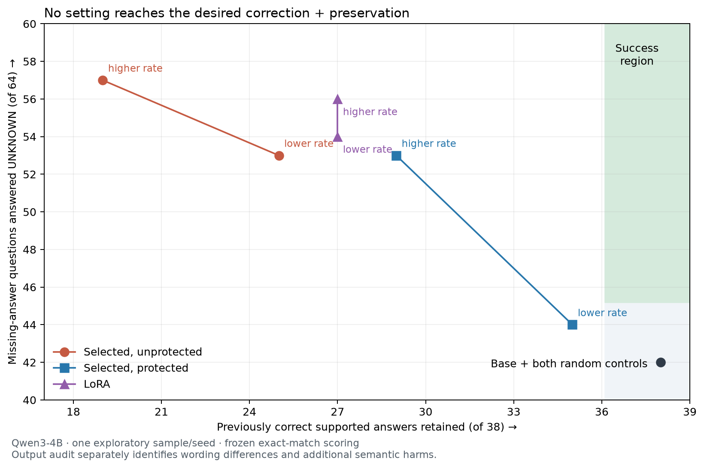

# Protection reduces interference, but this candidate is not ready

The frozen eight-fit Qwen3-4B pilot completed. **No setting meets the declared
correction and preservation criteria.** There is a partial signal worth explaining:
at the same missing-answer score, protected selected rows retain four more
previously correct answers than unprotected selected rows. This is one exploratory
sample and one seed, not a confirmed superiority result.

Kaggle remained queued for about 27 minutes. We verified a standard Colab T4 in
the personal account, cancelled the Kaggle copy, and executed the **byte-identical
original payload** there. The pinned model, data, runtime packages and protocol
were unchanged. CUDA preflight and all eight fits completed; the original runner's
restoration checks passed. The model comparison took 1733 seconds, about 29 minutes,
after environment setup. All 79 output files, including learned tensors, were
downloaded and checked. See [integrity.json](integrity.json),
[artifact_audit.json](artifact_audit.json) and [provider.json](provider.json).

## Frozen primary results

There are 64 supported and 64 missing-answer validation questions. Retention is
conditional on the **38 supported answers the base gets exactly right**. Utility
contains only 32 simple prompts; its retention denominator is 31. Each family
receives the same 160 adaptation labels, anchor replay and two learning rates.

| Condition | Rate | Supported correct /64 | Missing correct /64 | Old correct retained /38 | Utility correct /32 |
|---|---:|---:|---:|---:|---:|
| Base | — | 38 | 42 | 38 | 31 |
| Selected, unprotected | 0.0003 | 32 | 53 | 25 | 31 |
| Selected, protected | 0.0003 | 37 | 44 | 35 | 31 |
| Random, protected | 0.0003 | 38 | 42 | 38 | 31 |
| LoRA | 0.0001 | 33 | 54 | 27 | 31 |
| Selected, unprotected | 0.001 | 23 | 57 | 19 | 32 |
| Selected, protected | 0.001 | 36 | 53 | 29 | 31 |
| Random, protected | 0.001 | 38 | 42 | 38 | 31 |
| LoRA | 0.0003 | 33 | 56 | 27 | 31 |

The stronger protected update gets 53 missing questions right and retains 29 old
answers. The weaker unprotected update also gets 53 missing questions right but
retains only 25. The protected setting still loses **9/38** old exact-correct
answers, far below the required 95% retention. The weaker protected setting loses
3/38 and improves missing accuracy by only 2/64. Random rows show no aggregate
accuracy improvement, although some strings and refusals change.

LoRA offers a different trade-off, reaching 56 missing answers while retaining
27/38. All settings are reported in [the generated audit](analysis/REPORT.md),
with paired article-bootstrap intervals in [summary.json](analysis/summary.json).
There is no family winner satisfying the preservation rule, and the observed
four-answer comparison is not a significance claim.

Regenerate with `python experiments/protected_rows/plot_tradeoff.py --summary
experiments/protected_rows/colab_v1/analysis/summary.json --output
experiments/protected_rows/colab_v1/analysis/tradeoff` (requires matplotlib).

## What actually breaks

Even the weaker protected update changes three correct answers into UNKNOWN:
the SNES button color (purple), composition of two rotations (a rotation), and
lighting supply (low-voltage transformer windings). The stronger setting also
introduces refusals, an echoed “what?”, and shortened answers. This is real
interference, not just an exact-match scoring issue.

The four protected calibration trajectories remain byte-identical in greedy
generation for **every** family, including unprotected updates and LoRA. Replay
already preserves those four outputs; their success does not demonstrate broad
preservation. The protected input spans have rank 753 of 2560, leaving 1807
directions in each target layer. Finite anchor preservation does not transfer
reliably to new questions.

## The output audit changes how to interpret accuracy

The [baseline-only audit](baseline_output_audit.json) was written before reviewing
edited outputs. Its judgments are by the Codex assistant, **not independent human
adjudication**. It reviews all 48 primary baseline misses, not the entire dataset.
The primary frozen evaluator and criteria remain unchanged.

Of 26 supported exact-match misses, 19 already have correct content with different
wording, three are borderline, and four have content/refusal problems under that
review. A bare “seventh” correctly answers a ranking question whose gold is a
whole sentence. Conversely, appending an acute-accent codepoint to plain Unicode
e is a genuine error even though the correct codepoint appears as a substring.

Some missing labels are also problematic. The BBC passage explicitly says the
licence fee is paid annually, and an HDTV passage states the requested resolution
mechanism. Other questions are answerable by inference, such as 30% non-plains
from roughly 70% plains, but have no literal extractive answer span. Malformed
names and false-premise questions create further ambiguity. Do not call all such
cases annotation mistakes: extractive-policy compliance and useful grounded
reasoning are different objectives.

On the reviewed subset, the stronger protected setting fixes eight of 12 clear
missing-answer failures but adds six clear refusals among the 19 semantically
correct, non-exact baseline answers. Those harms are invisible to retention over
only the 38 exact-correct cases. Six of its seven new supported exact matches are
wording improvements; none repairs the four reviewed content/refusal failures.
These secondary observations are qualitative diagnostics, not revised gold scores.

## Implementation and cost limits

All eight fits execute 160 steps without gradient-scaler skips. The six row
artifacts have identical base fingerprints and expected supports, shapes and
FP16 deltas. Guided protected/unprotected supports match; random counts/layers
match. Both LoRA artifacts contain exactly 72 factor tensors and 442,368 scalars.
A stale peft_config warning on the second LoRA fit was audited: the saved suffix
targets all 36 up projections, initial losses/gradient norm match exactly, and no
extra saved adapter factors appear. This is not an independent cold-load forward
reproduction of every artifact.

Row fits train 245,760 scalars, with 173,472 effective linear dimensions when
protected; LoRA trains 442,368 scalars across all 36 layers. Row patches are about
0.50 MB versus 1.78 MB for LoRA. Row training takes about 60–64 seconds versus
93–94 seconds for LoRA, but strict base hashing adds about 34 seconds to row
export, versus less than one second for LoRA. Discovery and evaluation add cost.
These are different layer budgets and validation paths, not a general speed claim.

The stronger protected delta has Frobenius norm 7.36, versus 6.06 unprotected;
random is 8.35 with no accuracy gain. A smaller parameter norm cannot explain
the result. Functional steering strength could still explain it.

## Next discriminating check

**Update:** the [saved-weight diagnostic completed](../dose_v1/REPORT.md).
Both exported patches reproduce all 320 checked outputs exactly. Matching
refusal strength exposes a trade-off rather than a clean protection win, and
a constant first-token bias captures part of the gain. The learned patches do
not improve the measured evidence-discrimination ranking on this sample.

The diagnostic used the saved weights without further training. It matched the
unprotected update's mean refusal-log-odds shift to the protected update on
calibration prompts, then compared their validation answers. It also compared a
first-token UNKNOWN logit bias with the same calibrated shift. The
[frozen diagnostic protocol](../dose_protocol.json) set the finite scale grid,
one interpolation, cold-load reproduction gate and 900-second limit. This is
exploratory on exposed data.

If those simpler controls reproduce the benefit and failures, pursue the missing
conditional discrimination rather than attributing progress to a new geometric
method. Any promising candidate still needs the protection-matched low-rank
control, better specified evidence labels, fresh confirmation, additional seeds
and another model/task. The broader library goal remains incomplete.
