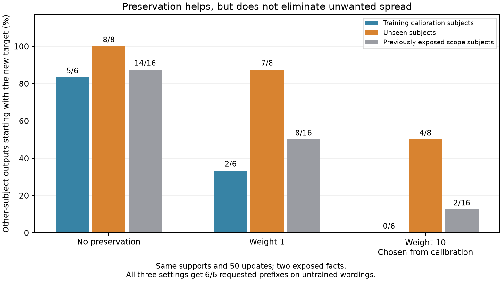
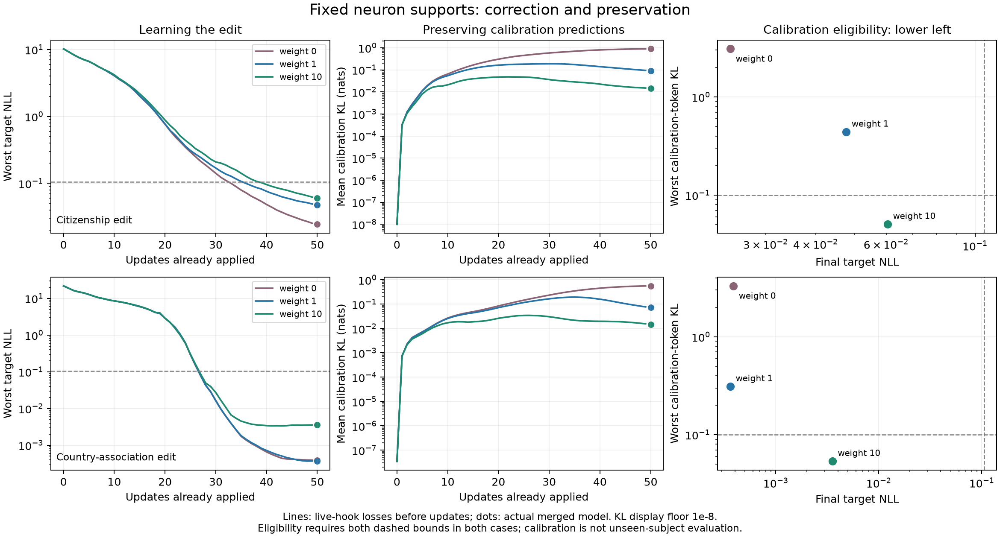

# Preservation improves binding, but does not generalize enough

The frozen fixed-support experiment finds a real partial improvement. The
calibration-selected preservation weight 10 retains all 6/6 requested prefixes on
untrained wordings, removes target leakage from all six calibration subjects,
and reduces leakage on eight unseen subjects from 8/8 to 4/8. It fails the declared
scope gate, which requires at most 1/8. No larger confirmation run or public
behavior recipe is justified for this candidate unchanged.

## Frozen selection and comparison

Two exposed GPT-J-6B facts, three correction phrases each and exact saved
cross-prompt-gradient occurrence supports. All six fits start from zero with
Adam lr .001 for exactly 50 updates. Weights 0,1,10 changes only the added preservation
term. There are 20,480/81,920 BF16 trainable scalars in the two cases; the base is
FP16 and frozen. This is an objective ablation, not a selector improvement test. Each patch edits one fact independently; simultaneous or sequential multi-edit behavior is untested.

Three calibration subjects per edit supply the base distributions over the first
up to four answer predictions, under fixed base-generated contexts. Labels are
not trained. Four different evaluation subjects per edit were frozen before
inference. Previously exposed scope prompts and unrelated utility are separate
secondary banks. None of the prepared eight fresh facts or indices >=512 is
inferred on by this worker.

The registered rule chooses the smallest positive weight whose **both** edited
cases have final maximum target NLL <= -log(.9) and every calibration-token
KL(base||edited) <= .1. Selection uses the actual merged FP16 model, not live hooks
or generated evaluation scores. Independent reconstruction from saved logits
selects 10, exactly as the worker did. Weight 1 fails the worst-token bound despite
low average calibration KL. Every setting is reported.

| Preservation weight | Original edited prompts | Untrained edited wordings | Calibration target leakage | Unseen-subject target leakage | Exposed-scope target leakage |
|---|---:|---:|---:|---:|---:|
|0|2/2|6/6|5/6|8/8|14/16|
|1|2/2|6/6|2/6|7/8|8/16|
|10, chosen from calibration|2/2|6/6|0/6|4/8|2/16|

These are requested answer starts, not complete correct answers. The edits are
deliberately counterfactual research targets. Six wordings are correlated views
of two facts; this is development evidence, not eight independent edits or a
paper-superiority result.

## What generalizes and what fails

For citizenship, weight 10 reduces unseen leakage 4/4→2/4 and exposed leakage 8/8→1/8.
For country association, the corresponding changes are 4/4→2/4 and 6/8→1/8. Calibration
improves strongly, but both cases still leak on two unseen subjects. The frozen
count gate passes original-target retention, transfer, relative reference retention
and global-utility retention; it fails the absolute scope requirement.

The remaining unseen copied-target subjects are Tammy Abraham and Charli D'Amelio
in the citizenship case, and Manchester United F.C. and BBC World Service in the
country-association case. These are explicit new-target answers, not alias misses.
Two originally reference-prefix-correct unseen answers are overwritten. Weight 10
retains 3/5 baseline-reference-correct unseen prefixes versus 0/5 for weight 0.
Only 5/8 baseline evaluation questions have a reference prefix; reference labels
are benchmark data, not independently validated current facts.

Both remaining association failures have UK reference answers, whereas that
edit's three calibration records cover other references. This is a **post-hoc
coverage hypothesis**, not an established causal explanation. Calibration can
protect supplied contexts without identifying a generally subject-specific edit.
The current off-subject evaluation also uses a single exact relation template;
it does not cross new subjects with new wordings. Future confirmation needs both.

There is an alias miss in the exposed bank: "Russia" becomes "the Russian
Federation". Frozen exposed retention is 4/5 for weight 10; supplemental country-
identity review retains 5/5. The unseen leakage 4/8 and its two real reference losses
are unchanged. A shorter United States name also causes one weight 1 calibration
prefix miss. These observations do not alter the frozen scorer.

## Complete capped-output review

All 424 saved generations were reviewed as 308 distinct question/reference/output
contexts: 43 edit, 18 calibration, 29 unseen evaluation, 56 exposed-scope and 162
utility contexts. Exact duplicates retain all condition occurrences. This is an
assistant qualitative review, not blinded independent human factuality labels.
All 424 generations reach the 40-token cap; complete observed text is not a complete response.

All settings retain 16/16 baseline-prefix-correct utility observations, which
represent **eight unique questions under two edits**. The base is prefix-correct
on only 8/32 unique utility questions. Edited total prefix hits are35/64,33/64 and
29/64 for weights 0,1,10. Much of the increase comes from naming capitals where
the base generates generic descriptions. These are not whole-answer quality
scores or evidence of newly learned geography. Exact utility continuation
agreement remains only 5/64, 6/64, 7/64 respectively; change is not uniformly damage.

The selected patch still produces unsupported personal allegations, fabricated
history and repetition after its requested target prefixes. Those generated
allegations are false model output and are not republished. Base outputs already
contain unsupported biography and other problems; the earlier answer-prefilled
control showed that not every bad tail can be attributed to editing.

A harmless concrete collateral error shows what prefix retention misses. After
the selected country-association edit, the water answer starts with the expected
`H2O`, then says **"The chemical formula for ice is H2O2."** The paired base lacks
that incorrect claim. Thus preserving a correct answer start does not preserve
the rest of an unrelated answer. The selected citizenship patch also removes
the base's later Berlin mention within the observed 40 tokens despite incurring
no leading-prefix loss on that question.

Calibration itself is not a factuality target: several base calibration answers
are unknown, incomplete or inconsistent with source references. Preserving their
distributions is not the same as preserving correct knowledge. Even under the
selected small KL bound, the association case retains 11/12 calibration argmax
tokens, not 12/12; a soft probability constraint does not guarantee identical text.

## Training and update geometry

Both weight 10 fits satisfy the registered training/calibration bounds. Their
final target NLLs are 0.06049 and 0.00355, maximum calibration-token KLs 0.05050 and
0.05343, and mean calibration KLs 0.01455 and 0.01475. The corresponding unprotected
mean KLs are 0.89162 and 0.56093. All are measured after sequential merging; live
metrics are retained separately in [fits.json](fits.json).

The [post-hoc geometry](geometry.json) shows weight 10 changes both update direction
and magnitude: occurrence norms are 0.928/0.971 of unprotected norms, and linear
summed-update cosines are 0.902/0.967. These comparisons use float64 duplicate
summation, not actual sequential FP16 weight differences. No dose-matched causal
control has run, so geometry cannot establish which change explains preservation.

The weight 0 control continues for 50 steps; it is not the earlier pilot's
early-stopped patch. Its first 34/28 recorded target-NLL values match the earlier
consensus traces exactly. It leaks 14/16 on the exposed bank versus the old 9/16.
This is consistent with additional target fitting worsening interference, but
does not establish exact intermediate delta parity or a general stopping rule.

## Next decision

Keep these cases as development regressions. Do not scale the unchanged candidate
as a validated editor. The same small support can learn a useful calibration
constraint while retaining target transfer, so the result is not evidence of
an absolute inability to bind an edit. The remaining problem is generalization
and full-response quality, not just optimization on the supplied examples.

The next controlled comparison should test mean-gradient supports and the broad
official LoRA baseline under clearly specified correction/preservation objectives
and calibration-only tuning. That helps distinguish restricted-support effects
from insufficient calibration coverage. Stronger preservation-aware selection is
a hypothesis to test, not a new method claim. Norm/dose controls, fresh facts,
crossed subject/wording tests and a stronger answering model remain necessary.
The broad LoRA helpers are CPU-verified; no full-size LoRA result is implied here.
The overall library goal remains incomplete.

## Execution and evidence

- Kaggle kernel 139969733 version 1 completed on 2026-10-21, return 0. One worker,
  two Tesla T4s allocated, CUDA0 used. Worker 2634.69s; wrapper 2741.28s, about 45.7min.
- Pinned model/runtime and exact source/data. Independently pulled source is
  byte-identical to the 222066-byte upload, SHA256
  `619b9e4cde4111f315c001be8cc254e4b6faef18686226170384ecd95ef268a1`.
- All 8 cold reference sequences match before new inference, all 6 fitted conditions
  restore base generation, and the final full base fingerprint matches exactly.
- Independent verification decodes 424 sequences, validates all saved supports,
  BF16 deltas and 50-step budgets, and recomputes 6 final calibration records and
  the global penalty choice from saved logits. No test outputs choose the weight.

See [integrity](integrity.json), [completion](completion.json), [provider](provider.json),
[cold checks](cold-checks.json), [summary](summary.json), [decisions](decisions.json),
[review index and notes](review.json) and [execution log](execution.log).
Raw text/tokens and calibration tensors remain in local downloaded artifacts.
Public hashes and decisions alone cannot independently rescore omitted text;
artifact access or a frozen rerun is required. Omission does not remove the
negative findings or justify a quality claim.
